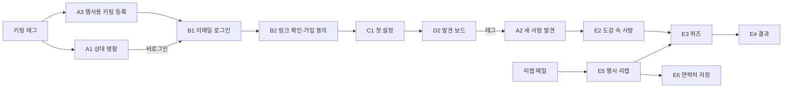

# Meetcha 화면 목록

> 2026-11-18 기준 서버(`server/`) 기능을 바탕으로 정리. 디자인과 함께 코드로 구현할 때의 작업 목록으로 쓴다.
> **우선순위** — P0: GSSC 파일럿 행사에 꼭 필요 · P1: 해외 밋업 판매 전 · P2: 있으면 좋음

## 화면 수 요약

| 구역 | 사용자 | 화면 수 | P0 |
|---|---|---|---|
| A. 태그해서 들어오기 | 참가자 | 4 | 4 |
| B. 로그인·가입 | 참가자 | 4 | 2 |
| C. 내 명함 | 참가자 | 5 | 3 |
| D. 행사장 | 참가자 | 4 | 2 |
| E. 다시 기억하기 | 참가자 | 6 | 5 |
| F. 소통·안전 | 참가자 | 4 | 1 |
| G. 설정 | 참가자 | 3 | 1 |
| H. 운영진 콘솔 | 운영진·주최사 | 10 | 5 |
| I. 소개 페이지 | 주최사(구매자) | 1 | 0 |
| **합계** | | **41** | **23** |

## 디자인 원칙 (모든 화면 공통)

1. **앱 설치 없는 모바일 웹.** NFC 태그로 휴대폰 브라우저가 바로 열린다. 첫 화면이 1초 안에 떠야 하고, 한 손으로 쓸 수 있어야 한다.
2. **행사 테마를 입힐 수 있게.** 행사 로고와 대표 색(`theme.color`)이 강조색을 덮어쓴다. 어떤 색이 와도 글자가 읽히도록 대비를 확인할 것.
3. **한국어·영어** 둘 다. 처음부터 문구를 분리해 두기.
4. **다크 모드** 지원 (행사장은 어두운 곳이 많다).
5. **퀴즈 화면은 Kahoot과 닮지 않게.** 프로토타입의 4색 + ▲◆●■ 조합은 Kahoot의 상징적인 디자인과 너무 비슷하다. 보기 모양과 색을 우리만의 것으로 바꿀 것 (예: 키링 모양 아이콘, 행사 테마 색 기반 4톤).
6. **"가려진 카드"는 Meetcha의 얼굴.** 발견 보드, 새 사람 발견 연출, 리캡이 같은 카드 언어를 쓰도록.

## 참가자 흐름

---

## A. 태그해서 들어오기

| ID | 화면 | 언제 | 담을 것 | 서버 | 상태별 화면 | 우선 |
|---|---|---|---|---|---|---|
| A1 | **상대 명함** | 남의 키링을 태그했을 때 | 이름, 직함·소속, 한 줄 소개, 외부 링크, "퀴즈 N문제가 도감에 저장됐어요", 비로그인이면 로그인 유도 | `GET /u/:id`, `GET /api/users/:id` | 전체 공개 / 만난 사람만(이름만 보임) / 탈퇴한 사용자 / 비로그인 | P0 |
| A2 | **새 사람 발견 연출** | 처음 태그한 사람일 때 (`?new=1`) | 가려진 카드가 뒤집히며 공개되는 애니메이션, "N번째 만남", 행사 진행률 | A1과 같음 + `found` 실시간 이벤트 | 행사 중 / 행사 밖 | P0 |
| A3 | **행사용 키링 등록** | 행사에서 받은 새 키링을 처음 태그 | 행사 로고·이름, "이 키링을 내 명함과 연결", 등록 + 체크인 버튼 | `GET /claim`, `POST /api/me/tags/claim-tap` | 비로그인 / 로그인 / 이미 다른 사람이 등록 / 시간 초과(30분) | P0 |
| A4 | **키링 안내** | 태그했는데 열 수 없을 때 | 이유와 다음 행동 | 서버 안내 페이지 | 분실 신고된 키링 / 주인 없음 / 확인 불가(위조 의심) / 이용 제한 | P0 |

## B. 로그인·가입

| ID | 화면 | 담을 것 | 서버 | 상태 | 우선 |
|---|---|---|---|---|---|
| B1 | **이메일로 로그인** | 이메일 입력, "메일함을 확인하세요" 안내 | `POST /api/auth/request` | 입력 / 보냄 / 요청 너무 많음 | P0 |
| B2 | **링크 확인·가입 동의** | 기존 회원은 로그인 버튼 하나. 새 회원은 동의 체크박스 3개(만 14세 이상, 약관, 개인정보) + 약관 보기 | `GET /auth/verify`, `POST /api/auth/verify` | 기존 회원 / 새 회원 / 링크 만료 / 이용 정지 | P0 |
| B3 | 약관 재동의 | 약관이 바뀌었을 때 바뀐 점 요약 + 동의 | `consentRequired`, `POST /api/me/consent` | | P1 |
| B4 | 이용 정지 안내 | 정지 사유, 기간, 이의 제기 방법 | `account_suspended` 응답 | 기간 정지 / 영구 | P1 |

## C. 내 명함

| ID | 화면 | 담을 것 | 서버 | 우선 |
|---|---|---|---|---|
| C1 | **첫 설정** | 이름·직함·소속(명단에서 미리 채워짐), 한 줄 소개, 행사 힌트("디자인", "투자" 등), 퀴즈 1문제 만들기까지 3단계 이내 | `GET /api/me`, `PUT /api/me/profile`, `PUT /api/me/quiz` | P0 |
| C2 | **내 명함 편집** | 프로필, 링크(최대 8개, https만), 공개 범위 3단계 설명 | `PUT /api/me/profile`, `PUT /api/me/links` | P0 |
| C3 | **내 퀴즈 만들기** | 질문 + 보기 4개 + 정답, 최대 5문제. 질문 템플릿 제안("제 주말 취미는?", "오늘 발표한 주제는?") | `PUT /api/me/quiz` | P0 |
| C4 | 내 키링 | 내 키링 목록(행사별 기념품 컬렉션처럼), 등록 코드 입력, 분실 신고 | `GET /api/me`의 `tags`, `POST /api/me/tags/claim`, `POST /api/me/tags/:id/lost` | P1 |
| C5 | 남에게 보이는 내 명함 | 공개 범위별로 상대에게 어떻게 보이는지 미리보기 | A1 재사용 | P2 |

## D. 행사장

| ID | 화면 | 담을 것 | 서버 | 상태 | 우선 |
|---|---|---|---|---|---|
| D1 | 체크인 | 입구 QR/코드로 체크인, 리더보드 공개 동의 | `POST /api/events/checkin` | 성공 / 코드 오류 / 끝난 행사 | P1 (P0 파일럿은 A3·H7로 체크인) |
| D2 | **발견 보드** | 행사 테마, 진행률(3/24), 가려진 카드 + 힌트, 찾은 카드는 얼굴 공개. 새 참가자가 오면 카드 추가 | `GET /api/events/:id/board`, 실시간 `checkin`·`found` | 행사 전 / 진행 중 / 끝남(→ E5로) / 아무도 없음 | P0 |
| D3 | **실시간 소식·알림** | "OO님이 나를 태그했어요" 토스트, 활동 소식("참가자 한 명이 새 사람을 만났어요"), 체크인 수·만남 수 | `GET /api/events/:id/stream` (SSE) | 연결 끊김 시 재연결 안내 | P0 |
| D4 | 리더보드 | 동의한 사람 순위, 내 순위, 동의 켜고 끄기 | `GET /api/events/:id/leaderboard`, `PUT /api/events/:id/leaderboard-consent`, 실시간 `leaderboard` | 동의 안 함 상태 | P1 |

## E. 다시 기억하기

| ID | 화면 | 담을 것 | 서버 | 우선 |
|---|---|---|---|---|
| E1 | **도감** | 행사별로 묶은 만난 사람 목록, 퀴즈 최고점, 만난 날짜 | `GET /api/dex?groupBy=event` | P0 |
| E2 | **도감 속 사람** | A1 + 퀴즈 풀기, 나만 보는 메모, 메시지 보내기, 연락처 저장, 더보기(신고·차단) | `GET /api/users/:id`, `PUT /api/users/:id/note` | P0 |
| E3 | **퀴즈 풀기** | 문제, 10초 타이머, 보기 4개, 정답 공개, 점수 | `POST /api/users/:id/quiz/attempts`, `POST /api/quiz/attempts/:aid/answer` | P0 |
| E4 | **퀴즈 결과** | 점수, 맞힌 수, "이 사람을 얼마나 기억하나요", 다시 풀기 / 다음 사람 | 응답의 `result` | P0 |
| E5 | **행사 리캡** ⭐ | 기념품 느낌의 핵심 화면. "GSSC 네트워킹 나이트에서 12명을 만났어요", 나를 만난 사람 수, 순위, 만난 사람 카드 모음, "아직 안 푼 퀴즈 5개" → 한 명씩 풀기, 공유용 이미지 | `GET /api/events/:id/recap` | P0 |
| E6 | 연락처 저장 | 한 사람 / 행사 전체를 휴대폰 연락처로 | `GET /api/users/:id/vcard`, `GET /api/dex/vcard?eventId=` | P1 |

## F. 소통·안전

| ID | 화면 | 담을 것 | 서버 | 우선 |
|---|---|---|---|---|
| F1 | 받은 메시지 | 보낸 사람, 내용, 시간 | `GET /api/me/messages` | P1 |
| F2 | **메시지 보내기** | E2 안의 입력창 (500자) | `POST /api/users/:id/messages` | P0 |
| F3 | 신고하기 | 사유 5개 중 선택, 상세 내용 | `POST /api/users/:id/report` | P1 |
| F4 | 차단 확인 | "차단하면 메시지를 받지 않아요" 확인 단계 | `POST /api/users/:id/block` | P1 |

## G. 설정

| ID | 화면 | 담을 것 | 서버 | 우선 |
|---|---|---|---|---|
| G1 | **설정** | 로그아웃, 언어, 약관·처리방침, 탈퇴 | `POST /api/auth/logout` | P0 |
| G2 | 탈퇴 확인 | 무엇이 지워지고 무엇이 남는지(다른 사람 도감엔 "탈퇴한 사용자"), 확인 입력 | `DELETE /api/me` | P1 |
| G3 | 약관·처리방침 보기 | 국문/영문 전환 | `GET /legal/terms`, `/legal/privacy` | P1 |

## H. 운영진 콘솔 (노트북 우선, H7만 휴대폰)

| ID | 화면 | 담을 것 | 서버 | 우선 |
|---|---|---|---|---|
| H1 | **행사 목록·만들기** | 행사 이름, 고객사, 시작·종료 시각 | `POST /api/admin/events` (목록 API는 아직 없음) | P0 |
| H2 | 행사 대시보드 | 체크인 수, 만남 수, 실시간 그래프, 명단 대비 체크인률 | `GET /api/admin/events/:id/attendees`, 리포트, 실시간 | P1 |
| H3 | **명단 업로드** | CSV 끌어다 놓기, 열 인식 결과 미리보기, 잘못된 행 표시 | `POST /api/admin/events/:id/attendees/import` | P0 |
| H4 | **명단 현황·안내 메일** | 초대 / 가입 / 체크인 상태, "카드 미리 만들기" 메일 보내기 | `GET .../attendees`, `POST .../invites/send` | P0 |
| H5 | 테마 설정 | 로고 URL, 색, 환영 문구 + 참가자 화면 미리보기 | `PUT .../theme` | P1 |
| H6 | **키링 발급** | 수량, 행사 연결, 결과(칩에 쓸 URL·등록 코드) 파일로 받기 → 3D 프린팅·칩 기록 작업에 사용 | `POST /api/admin/tags` | P0 |
| H7 | **체크인 데스크** (휴대폰) | 데스크 모드 켜기, 태그 결과를 크게 표시(✅ OO님 체크인 완료 / 이미 체크인 / 등록 전 키링) | `POST .../desk`, 태그 결과 페이지 | P0 |
| H8 | 신고 처리 | 신고 목록(쌓인 순), 처리·기각, 정지·해제 | `GET /api/admin/reports`, `POST .../resolve`, `.../suspend` | P1 |
| H9 | 고객사 리포트·리캡 메일 | 통계만(참가자, 만남, 평균, 퀴즈, 메시지), 리캡 메일 보내기 | `GET .../report`, `POST .../recap/send` | P1 |
| H10 | 입구 체크인 QR | 체크인 코드를 QR로 크게 표시·인쇄 | 이벤트 생성 시 받은 `checkinCode` | P2 |

## I. 소개 페이지

| ID | 화면 | 담을 것 | 우선 |
|---|---|---|---|
| I1 | 주최사용 소개 | "행사가 끝나도 서로를 기억하게 해 주는 기념품", 행사 크기별 상품, 키링 사진, 데모 영상, 문의 | P1 (해외 밋업 영업 전) |

---

## 화면을 위해 추가한 서버 기능 (완료)

| 기능 | 쓰는 화면 | API |
|---|---|---|
| 행사 목록 (운영진) | H1, H2 | `GET /api/admin/events` |
| 내가 참가한 행사 목록 (만남이 없어도 포함) | E1, E5 | `GET /api/me/events` |
| 키링 발급 결과 CSV | H6 | `POST /api/admin/tags` + `format: "csv"` |
| 프로필 사진 (재인코딩, 위치정보 제거) | A1, D2, E1 등 | `PUT/DELETE /api/me/photo`, 응답의 `photoUrl` |
| 리캡 공유 이미지 (1080×1350 PNG) | E5 | `GET /api/events/:id/recap/image` |
| 행사장 대형 화면용 공개 피드 | 대형 화면 (P2) | `POST /api/admin/events/:id/display`, `GET /api/display/:token(/stream)` |

남은 것: 리캡 링크를 SNS에 붙였을 때 미리보기 이미지가 뜨게 하려면 로그인 없이 볼 수 있는 공개 리캡 페이지가 필요하다 (본인이 공유를 켰을 때만). 디자인 단계에서 필요하면 추가.

## 파일럿(P0)만 먼저 한다면

참가자 화면 18개 + 운영진 화면 5개(H1, H3, H4, H6, H7). 그중 디자인이 가장 중요한 화면은 **A2 새 사람 발견 연출, D2 발견 보드, E3 퀴즈, E5 리캡** 4개다. 이 넷이 Meetcha의 인상을 결정하므로 디자인 시안을 먼저 잡고, 나머지는 같은 컴포넌트로 빠르게 만든다.
